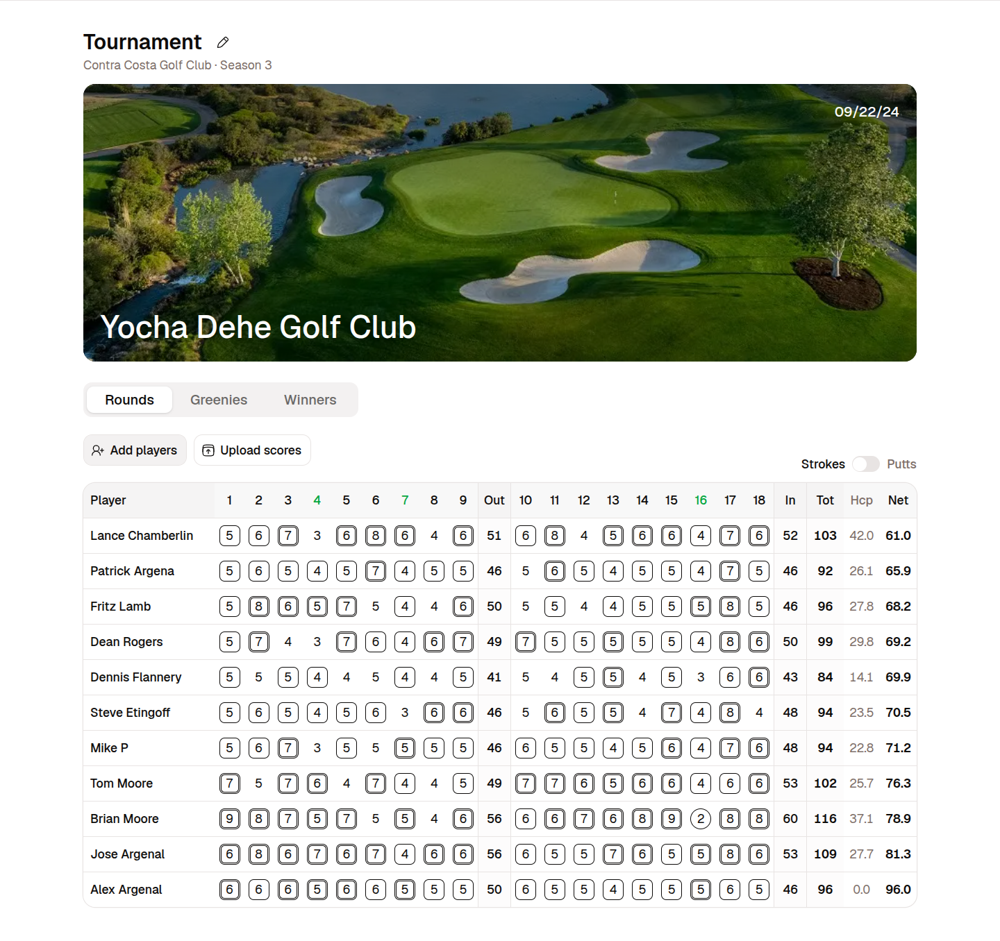
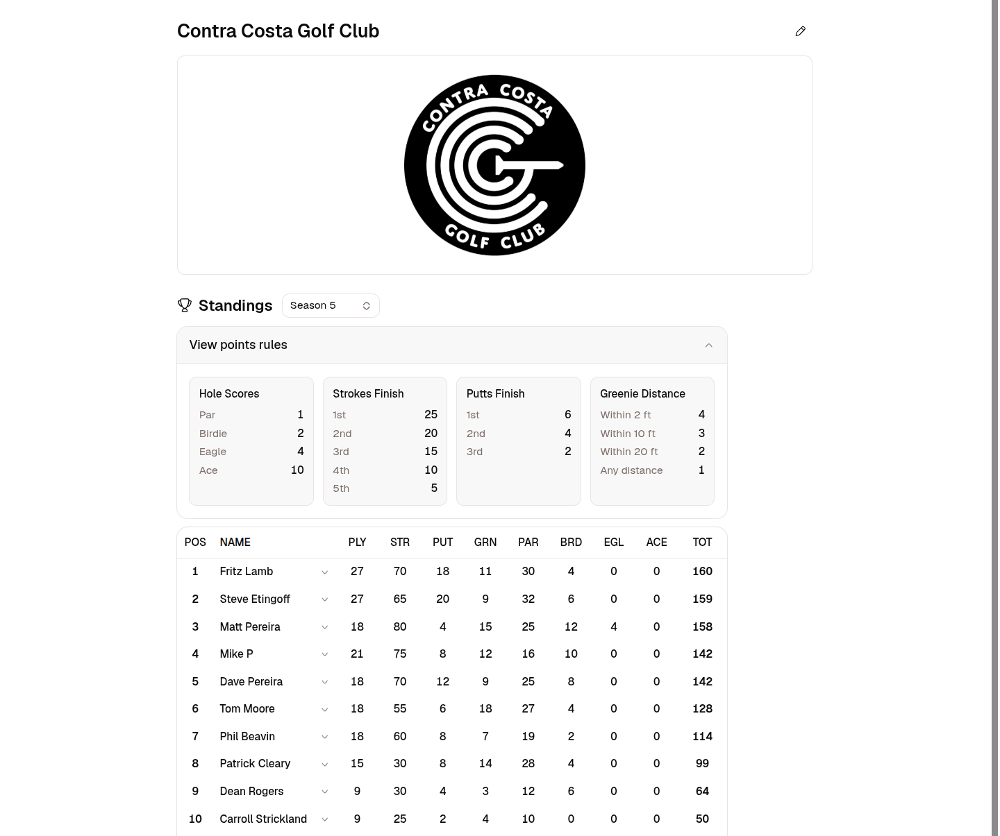
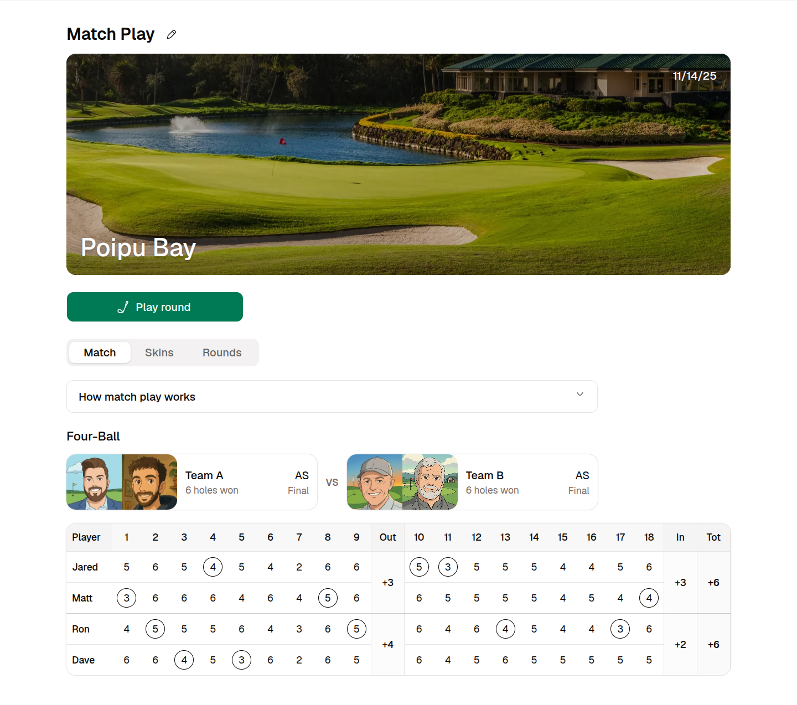
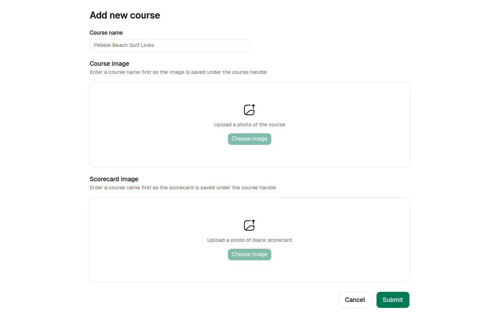
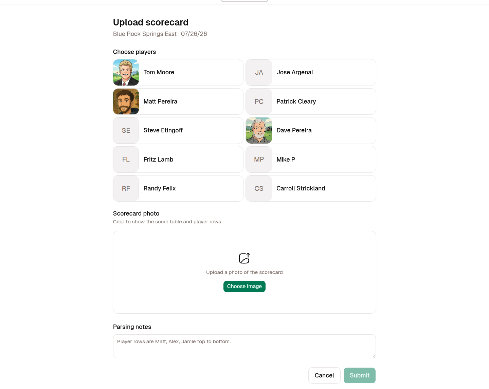
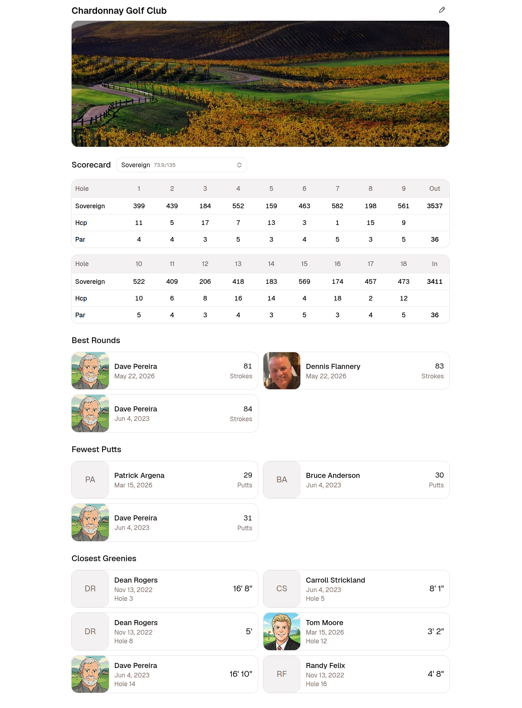

Track match play, skins games, tournament rounds, and season standings for golf clubs

### Features

- Track match play, skins games, and tournament rounds
- Organize clubs with customizable point scoring and season-long standings
- Use AI workflows to parse course data from scorecard images and upload round scores
- Compute USGA-style handicap indexes and course handicaps from every round played
- Browse all-time records — best rounds, fewest putts, closest greenies — per course and across every club

---

### Tournaments

A tournament is one date, one course, and a field of players. Scores are entered hole by hole, and the table computes each player's course handicap from their index and the tee's slope, then nets it out live. Greenies and winners are tracked alongside the round.



### Club standings

Clubs run numbered seasons, and every tournament in a season feeds one standings table. Each club configures its own points rules — what a birdie is worth, what finishing second in strokes is worth, how close a greenie has to be — and standings are derived from the underlying rounds rather than stored, so correcting a score three months later reorders the table.



### Match play and skins

Matches are casual and standalone — no club or season required. Singles, three-ball, and four-ball are scored per hole on relative playing handicaps, with four-ball at the 90% allowance. Skins run on the same round: a tied hole carries its skin forward until someone wins it outright.



### Scorecard import

Adding a course by hand means typing 18 yardages, 18 handicap indexes, and 18 pars for every tee. Instead you upload a photo of the scorecard and a model parses it into tees and holes.



The same thing works for a played round: pick the players, photograph the card, and per-hole scores land on their rounds. A free-text notes field handles the cases a model can't infer on its own, like which player each row belongs to when the handwriting is ambiguous.



### Courses

Every course keeps a scorecard per tee with its rating and slope, plus its own leaderboards — best rounds, fewest putts, and closest greenies — accumulated from every round played there. A global [records page](https://opencaddie.app/records) does the same across all courses, and each player has a profile with their round history and current index.



---

### Under the hood

- **AI scorecard import with an eval harness.** Imports run server-side and are resumable across sessions. `evals/scorecard-import/` scores model output against hand-checked expected JSON for real scorecards, so swapping models is a measured decision — current runs compare Claude Haiku 4.5 against Gemini 3.1 Flash Lite.
- **Imports reconcile against history.** Re-importing a course that already has rounds played on it can't clobber the past. Tees referenced by old rounds are retained as placeholder tees and require an explicit disposition — map to an imported tee, or keep unchanged — before the import commits.
- **USGA-style handicap pipeline.** Score differentials are derived per round, a player index is the best 2 of the last 4, and that index is scaled by course slope into a course handicap. A round can carry a hand-entered index override for casual play, which flows through the same slope scaling rather than being applied to net strokes directly.
- **Format-aware match scoring.** Match play, three-ball, four-ball, and skins each resolve strokes from relative playing handicaps with format-specific allowances, and skins carry over across tied holes.
- **Seasons as first-class records.** Clubs own numbered seasons with per-club points configuration; past seasons stay editable and can still receive tournaments.
- **Nightly cleanup cron.** A scheduled job expires abandoned in-progress imports so half-finished uploads don't accumulate as orphaned blobs and rows.

### Tech stack

- **Framework** — Next.js 16 (App Router), React 19, TypeScript
- **Database** — Postgres on Neon in production, a local Postgres in development; Drizzle ORM with generated migrations
- **Auth** — Auth.js with the Drizzle adapter, Google OAuth and Resend email sign-in
- **AI** — Vercel AI SDK through the AI Gateway, with a model eval harness
- **Storage** — Vercel Blob for course, scorecard, and avatar images
- **UI** — Tailwind CSS v4, shadcn/ui on Radix, Motion for animation
- **Testing** — Vitest, with integration tests against a real Postgres instance
- **Hosting** — Vercel, including a nightly cron job

---

### Local development

Development runs on a local Postgres, never on Neon. You need Postgres 18 (its `pg_dump` must be at least prod's version) and a role that can `CREATEDB`.

```bash
pnpm install
pnpm env:pull            # app secrets into .env.local (needs `vercel link`)
createdb open_caddie
createdb open_caddie_test
```

`.env.development.local`, which `pnpm dev`, the `db:*` commands and drizzle-kit read before `.env.local`:

```bash
DATABASE_URL=postgresql:///open_caddie?host=/var/run/postgresql
DATABASE_DRIVER=node-postgres
PROD_READONLY_DATABASE_URL=   # a read-only login on prod; only for db:pull-prod
```

`.env.test`, for `pnpm test` (each worker gets its own copy of `open_caddie_test`):

```bash
DATABASE_URL=postgresql:///open_caddie_test?host=/var/run/postgresql
TEST_DATABASE_URL=postgresql:///open_caddie_test?host=/var/run/postgresql
DATABASE_DRIVER=node-postgres
```

Keep `DATABASE_URL` a URL: `db:pull-prod` and `dev:prod` swap its database name.

**The seed** (`open_caddie`), the default for everything:

```bash
pnpm db:reset              # empty, migrate, seed
pnpm dev
pnpm -s db:sign-in admin   # a sign-in link for a Platform Admin; open it
```

**A copy of prod** (`open_caddie_prod`), read from prod and never written back:

```bash
pnpm db:pull-prod          # dump prod, restore, apply this branch's migrations
pnpm dev:prod              # pnpm dev on the copy
```

Sign-in sessions and linked Google accounts are not copied: sign in with `pnpm -s db:sign-in admin`, which finds the real Platform Admin.

`pnpm check` runs format, lint, module boundaries, typecheck and tests.
